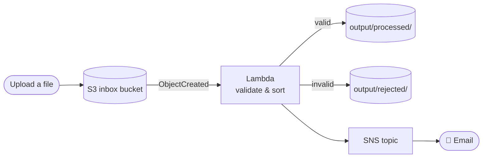

# ☁️ Zero Server Cloud Build

**Serverless file processing on AWS: S3 → Lambda → SNS, with least-privilege IAM.**
Hands-on lab from the AWS module, DevSecOps program, School of Hi-Tech and Cyber Security, Bar-Ilan University (January 2026).

> **The challenge:** take a daily file-processing task and solve it with 100% automation. No servers allowed.

---

## What it does



| Component | Role |
|---|---|
| **S3 inbox** | The trigger: a new file fires an event |
| **Lambda (Python)** | The brain: checks file type and content, routes the file, cleans up the inbox |
| **S3 output** | Sorted results under `processed/` and `rejected/` |
| **SNS** | The reporter: one email per file with the outcome |

### Validation rules

A file is **processed** if it is `.csv`, `.txt` or `.json`, not empty, and valid UTF-8 text. Anything else is **rejected**, and the email says why.

## Security: least privilege

Every component gets exactly the permissions it needs, on exactly one resource:

| Permission | Resource |
|---|---|
| `s3:GetObject`, `s3:DeleteObject` | Inbox bucket objects only |
| `s3:PutObject` | Output bucket objects only |
| `sns:Publish` | The one notification topic |
| `logs:*Log*` | The function's own log group |

Both buckets block public access and encrypt at rest. Only S3 events from this account can invoke the function.

## Deploy

Requires the AWS CLI and an S3 bucket for packaging the Lambda code.

```bash
aws cloudformation package \
  --template-file template.yaml \
  --s3-bucket <your-artifacts-bucket> \
  --output-template-file packaged.yaml

aws cloudformation deploy \
  --template-file packaged.yaml \
  --stack-name zero-server-cloud-build \
  --capabilities CAPABILITY_IAM \
  --parameter-overrides NotificationEmail=you@example.com
```

Confirm the SNS subscription email, then try the sample files:

```bash
aws s3 cp samples/ s3://zero-server-inbox-<ACCOUNT_ID>-<REGION>/ --recursive
```

`daily-results.csv` ends up in `processed/`; `empty.txt` and `image.png` end up in `rejected/`.

**Clean up:** empty both buckets, then `aws cloudformation delete-stack --stack-name zero-server-cloud-build`.

## Tests

The Lambda logic is unit-tested with fake S3 and SNS clients, so no AWS account is needed:

```bash
pip install -r requirements-dev.txt
pytest
```

## Tech

AWS CloudFormation · S3 · Lambda (Python 3.12, boto3) · SNS · IAM · pytest · GitHub Actions
